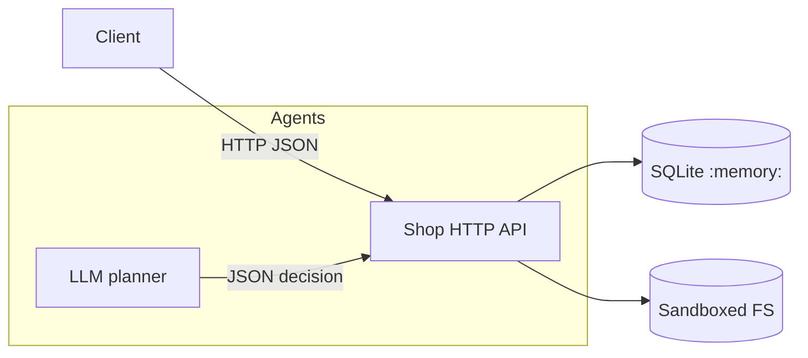

# Threat Model for Mini Shop

Scope: Single-process local HTTP service with in-memory SQLite and a temporary sandboxed filesystem. Identities: alice (customer, id=1), bob (customer, id=2), staff (staff, id=0). Client communicates over loopback only.

System Diagram (mermaid):

Trust Boundaries:
- HTTP boundary: only 127.0.0.1 transport, but untrusted client data in headers, query, body.
- Sandbox filesystem: physical boundary enforced by sandbox.py; logical access control must be in service.py.
- LLM boundary: model output is untrusted; server must validate tools and arguments.

Assets:
- Customer profiles (PII-like test data).
- Orders and prices.
- User receipts under files/<user>/.
- Operator note in private/.
- Access logs.

Threats and Findings (as-shipped vulnerable):
- IDOR: /profile?id=… exposes arbitrary profile by id.
- SQL injection: string formatting in /profile, /search, /assistant/context.
- Broken Access Control:
  - /orders GET returns all orders to any caller.
  - /admin/export trusts X-Role header instead of session.
  - /files allows arbitrary user/path; can read other users’ receipts and private directory within sandbox.
  - /debug/logs exposes logs to anyone.
  - /assistant/execute executes arbitrary tool without authZ on tool.
- Price tampering: client can POST orders with arbitrary price.
- XSS: /reviews/view reflects unescaped HTML from reviews.
- Prompt injection surface: reviews are included verbatim into assistant context; planner could be tricked into exporting profiles or deleting data; server must validate anyway.

Mitigations Implemented:
- Require session for sensitive endpoints; derive role from server-side session only.
- Parameterized SQL queries for profile/search/context.
- Orders GET filtered by owner for customers.
- Enforce catalog price server-side.
- Files endpoint scoped to caller’s username only.
- Logs restricted to staff.
- Escape reviews in HTML view.
- Assistant context returns only caller’s own orders.
- Assistant execute enforces per-tool authorization and path scoping.

Residual Risks:
- Denial of service via large request bodies is partially mitigated (size capped at 64 KiB already).
- Staff can delete sandbox trees via tool; considered allowed in the exercise.

Abuse Cases to Test:
- Customer attempting to read other user’s receipt or private note via /files or assistant read_file.
- Customer setting custom price in order.
- Non-staff calling /admin/export and /debug/logs.
- SQL injection via name search.
- XSS via review text.
